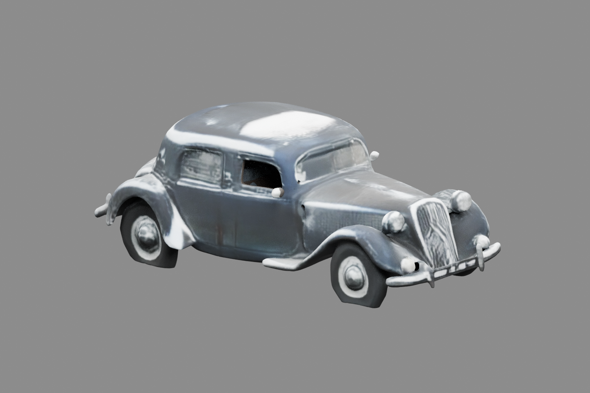
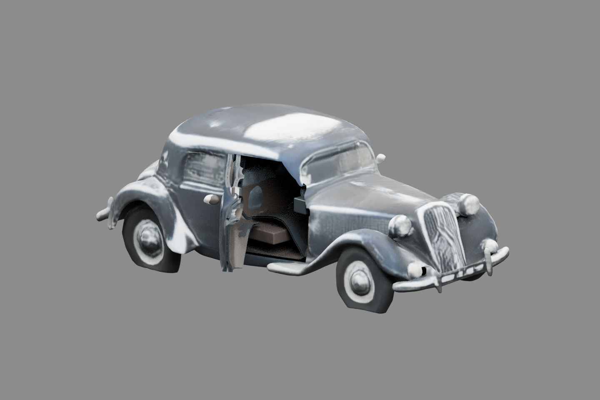
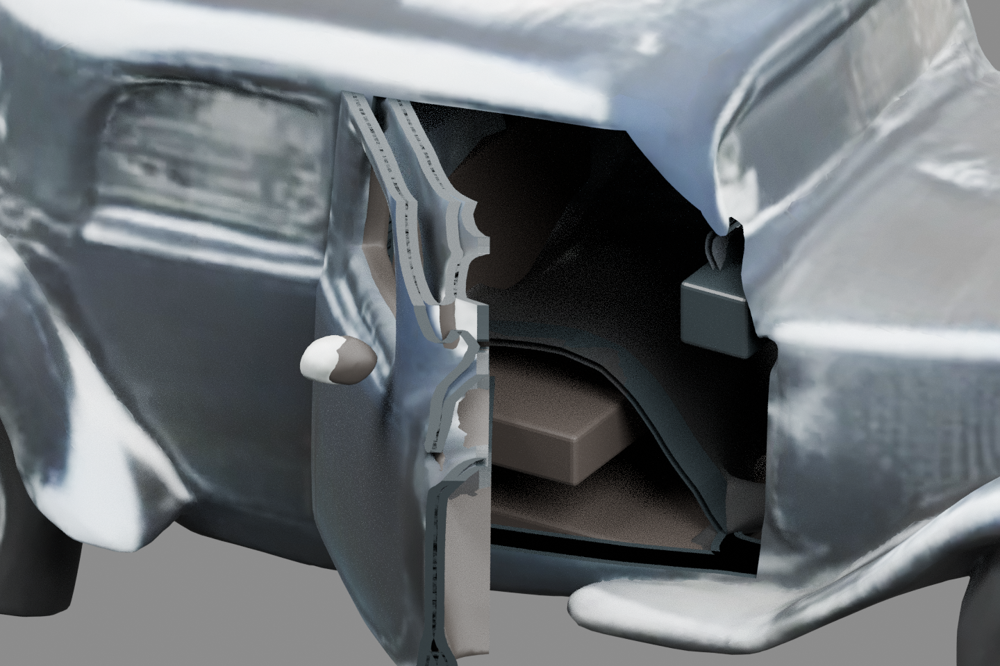

# Available TRELLIS.2 assets: functional door control, unresolved visual-use target

Completed 10 October 2026 (Asia/Bangkok). The directory retains the phase identifier `20261009`.

**Decision: stop this bounded car screen with an inspectable technical partial result.** Supplied asset A can retain its native exterior textures, be separated using ordinary geometry operations, carry a reversible door control, and survive GLB export/reopening. The declared convincing-CGI opening does **not** pass our visual screen: the open frame/edge is visibly layered and ragged, and the exposed cabin remains a crude completion. This is not an artist acceptance study, a controlled resolution comparison, or a demonstrated research contribution.

The strongest remaining explanation is **the conventional selection/cut/completion recipe interacting with the generated surface**, rather than an intrinsic inability of TRELLIS.2 to produce usable assets. We did not establish the ceiling or human cost of competent manual preparation. Do not start a method-development or generation campaign from this single partial result.

## What evidence changed

The user supplied two GLBs after running TRELLIS.2 directly on Hugging Face while signed in. This phase therefore moved beyond the historical access blocker without repeating acquisition, changing model, or spending money. The older TripoSR visual failure and blocked TRELLIS.2 requests remain distinct historical runs. A separate car experiment still has no verified identity; the proposed non-car revision study remains unstarted. Neither was duplicated.

| Supplied file | Label | Bytes | Native vertices / triangles |
|---|---|---:|---:|
| `sample_2026-10-09T183055.354.glb` | A | 10,060,500 | 183,392 / 291,603 |
| `sample_2026-10-09T183324.855.glb` | B | 10,297,284 | 178,694 / 276,585 |

[Provenance and SHA-256](inputs/PROVENANCE.json). The user reports trying **512 and 1536**, but file-to-resolution mapping, seeds and decimation are unknown. The conditioning image was the dark Citroën probe reference; the exact uploaded bytes and original-versus-background-removed variant are unknown. An earlier failed-run screenshot with Randomize Seed is excluded as provenance. Both outputs contain two 2048² textures; that is an output observation, not a generation/export configuration log. Embedded metadata identifies a trimesh exporter, not a pinned generator revision.

Both assets were inspected. **A was chosen by filename order for authoring**, not by favorable output selection. B received raw rendering, material controls and import/export checks but no door preparation; the authored result cannot be generalized to B. The cars have different coordinate frames: A's long axis is Blender X, B's is Y. Common world-axis view labels are not semantically matched A/B cameras.

## Executed controls and findings

| Actual check | Observed result | What it does not establish |
|---|---|---|
| Original GLB validation, A and B | Zero errors and warnings; native UV/normals and embedded base-color + metallic/roughness WebP | Artist usability, mechanical parts, exact generation provenance |
| Unmodified Blender import → export → fresh import, both | Every ordered triangle position/UV, triangle count, encoded texture and effective material value preserved. Normal drift mostly tiny; exported validators have zero issues | Exact normal identity or universal DCC compatibility |
| Native PBR, unlit base-color and clay views | Lighting/material presentation changes the apparent dark/silver body markedly; shape irregularity, A's window aperture and small detached underbody piece persist geometrically | A photometric material fit or a model ranking |
| A raw versus partition-only closed, identical 1440×960 camera/settings | Full-image RGB MAE **1.374×10⁻⁶** on a 0–1 scale; foreground MAE 6.56×10⁻⁶. Partitioned surface area equals source area numerically | Semantic correctness of the selected door or valid newly exposed surfaces |
| Completed authored A versus freshly reopened GLB, six hero/side poses | Full-image RGB MAE **2.24×10⁻⁶ to 1.74×10⁻⁵**. Both original WebP payloads are byte-identical in the final GLB | Every UV interpolation independently verified or any visual target met |
| Reopened animation | 121 samples; monotonic 0→60→0°, 2 s each way, maximum sampled angle error **2.11×10⁻⁵°**; forward/reverse matrices match; fixed body stays within 10⁻⁷ matrix tolerance | Continuous collision clearance, physical hinge accuracy, glass semantics or human usability |
| Final GLB validator | Zero errors/warnings, five informational unused-UV messages on plain added surfaces | Quality of those surfaces |
| Open-door visual screen, including reopened close-up | Visible aperture and moving assembly, but conspicuous irregular frame/edge and crude interior | A convincing-CGI pass; no artist acceptance was obtained |

[Integrity report](research/integrity/REPORT.md), [same-camera measurements](research/final_validation/control_measurements.json), [reopened motion](artifacts/reopened_A_v1/motion_verification.json), [native texture preservation](research/final_validation/native_texture_preservation.json), [final schema validation](research/final_validation/authored_gltf_validation.json).

The ordinary Blender roundtrip changed more than 0.1° at only 33/21 corners in A/B, on faces totaling 0.002499%/0.001215% of area. The largest angular changes occur on degenerate faces. Native seam-split index graphs must not be read as thousands of physical fragments: exact-position diagnostic graphs have 11/3 components and one dominant car component. No welding or repair was applied in that diagnostic, and connectivity alone supplies no semantic door.

## Concrete authoring performed

The inherited [artist-use brief](config/INHERITED_AUTHORING_INTENT.md) remained in force: visible front cabin door, coherent moving assembly, reversible 0–60°, recognizable dark Citroën, declared hero/side and exposed-edge/cabin views. We did not redefine a successful mechanical transform as the full use target.

The old TripoSR cutter/authoring scripts rebuild vertex-color geometry and would discard native UV/PBR. They were inspected and not reused unchanged. The new [ordinary clipping script](source/author_door.py) carries positions, UVs and corner normals through a manually specified convex door silhouette and near-side depth limit. It partitions the exterior without global remeshing/repainting or replacing the car. The source GLB is unchanged.

The [executed selection](config/door_A.json) uses A's actual coordinates, with a plausible rear hinge and outward rotation. The hinge is an authoring assumption, not recovered mechanical ground truth. Before execution, independent review raised the lower cut above the running board and added a safeguard limiting fixed jambs to newly cut boundaries. These were preparation choices, not demonstrated improvements over an executed earlier cut.

One completed authoring recipe was executed. It selected 15,064 triangles, retained 279,409 fixed triangles after boundary subdivision, and preserved total source surface area (3.557456472842865 native units²). Added, explicitly named geometry consists of a translated inner lining, edge strips, fixed jamb, floor, seat and dashboard proxies. Added materials are simple dark materials; the native exterior textures/PBR are retained. The selected window aperture remains open; no new coherent glass pane was manufactured. Coherent glass/handle identity is therefore not established merely by parenting the selected surface.

The `.blend` contains a `FrontDoor_Control` custom property and 121-frame open/close animation at 30 fps. The GLB contains the baked hinge animation. Script runtime was **191.6 seconds**, including renders, on CPU; this is not preparation labor, expert effort, or a quality–cost comparison. No physical scale or exact unseen interior is claimed. No second cut, cleanup campaign, model inference or training ran.

The final asset and DCC scene are [GLB](artifacts/authoring_A_v1/car_door_authored.glb) and [Blender scene](artifacts/authoring_A_v1/car_door_authored.blend). Native raw GLBs, partition-only scene, cut arrays/source-face IDs, added geometry, rendered poses, logs and failures are retained.

## Why the failure cannot yet select a research mechanism

The irregular open-edge sheets already appear in the **partition-only** open pose, before lining/jamb/interior additions. Completion is therefore not the sole explanation. The same defect remains after reopening, while closed appearance and textures are preserved; broad serialization loss is also a poor explanation for this tested path.

The saved [selection diagnostic](research/selection_diagnostic/FINDINGS.md) is more discriminating than a topology count. About **94.21% of selected area** consists of source faces wholly on the moving side, but clipped descendants trace many consequential exposed silhouettes. All 1,396 cut boundary edges lie on clipping planes; **18.96% of their length** lies on the Y-depth cutoff. About **40.59% of selected area** faces away from the nominal exterior direction at a ±0.5 normal threshold. Frame and tunnel surfaces can legitimately face inward; automatic deletion would be unjustified.

Thus original surface irregularity, semantic membership, contour/depth selection and completion remain entangled. A small boundary region can dominate the visible opening even if most area is original. The earlier possible window-boundary/jamb concern was not observed in the executed cut: no off-plane boundary edges were found. A visible aperture can be a tunnel in a closed mesh rather than an open mesh boundary.

A lower-exposure control restores a darker body without editing PBR, but the local open-edge defect remains. Conversely, a poor studio presentation should not become a sweeping claim about generated appearance. No objective target-fidelity metric, human judgment study, collision sweep or independently measured expert labor was collected.

Independent reviewers inspected history, integrity, the use brief, source and actual images. Their [final adversarial review](research/final_adversarial_review/FINAL_REVIEW.md) should be read alongside the direct measurement files; reviewer agreement is not a substitute for those observations.

## Next research decision

**Close the present scripted repair iteration; keep the broader project open.** The useful positive result is that current supplied outputs support native-texture-preserving DCC entry, surface partitioning and exported reversible control. This weakens any framing that a fused generated mesh alone prevents downstream use. The convincing opened-door target remains unmet in this particular preparation, and a publishable gap is not established.

The most informative next phase is a **competent conventional local preparation benchmark**, using a fixed deliverable and actual artist acceptance/active-edit cost. First test whether careful semantic selection, contour cleanup and coherent panel/jamb completion solve this residual at acceptable cost on the same asset. Retain this script as a documented baseline, not an expert upper bound. B may be assessed as a second supplied asset under its own provenance; it must not be labelled a resolution treatment.

Develop a method only if a consequential cost, reliability, control or quality residual survives that stronger baseline on prospectively chosen assets/operations, and a bounded prototype improves a declared endpoint at matched acceptance/effort. An improvement need not be dramatic. Compare against the cheapest relevant ordinary workflow, and against an accessible current commercial workflow when authorized access can change the decision. No paid comparator was run here; product claims and the old TripoSR result cannot stand in for one. If ordinary preparation is already adequate, close this method-gap formulation.

This next benchmark and any learned intervention are **proposals**, not completed work. No topology, articulation, appearance-transfer or model family is selected as the contribution.

## Inspection and preservation

The [self-contained viewer](artifacts/viewer/car_door_standalone.html) embeds the exact authored GLB and Three.js. Browser checks passed for measured 0/30/60° controls, repeated reversal, pause/reset, fixed body/jamb/cabin, and native PBR bindings, with no subsequent HTTP(S) requests or JavaScript errors. Verification caught and corrected a viewer-only one-frame offset: native animation keys begin at 0.033333335 s, so sampling from zero originally produced 29° instead of 30°. The first viewer build and failed checks remain preserved. This was a viewer timing error, not a model or GLB-geometry limitation.

Chromium's managed policy blocked direct `file://` navigation (`net::ERR_BLOCKED_BY_ADMINISTRATOR`). The policy was not bypassed. Functional verification used allowed loopback HTTP with subsequent network requests blocked; **direct local-file launch remains unverified**. The software-rendered run is not an FPS/smoothness or four-second wall-clock performance benchmark. [Viewer report](research/viewer/REPORT.md) and [reproduction instructions](source/viewer/README.md).

Use [DOWNLOADS.md](DOWNLOADS.md) for immutable download links, exact commits and external-readback receipts; use [SECRETARY_HANDOFF.md](SECRETARY_HANDOFF.md) for the operational handoff. Checkpoints were pushed and independently downloaded before subsequent substantive processing. A local ZIP or commit was never treated as the external backup. No exposed latent was supplied in this phase; server-held latent state and missing generation metadata cannot be claimed recovered.

Closed pose after export/reopening:

Open pose after export/reopening — visible local preparation defects remain:

Exposed edge and cabin:

